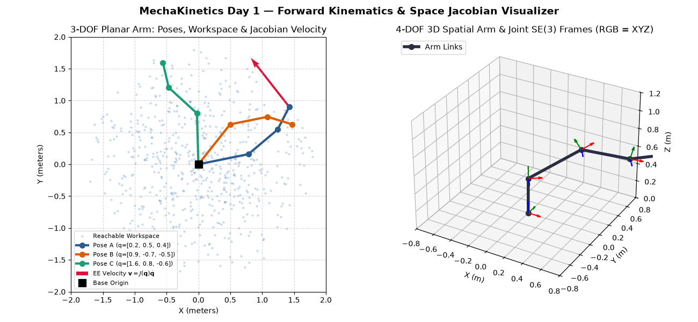
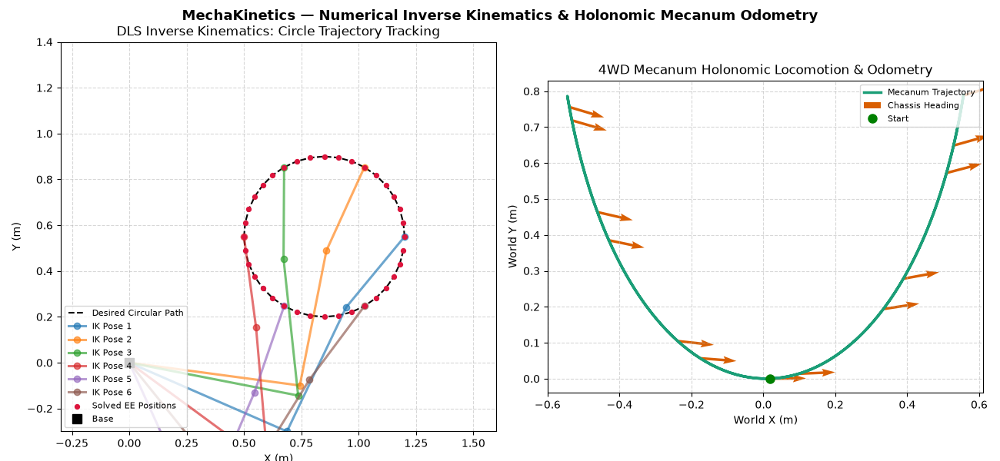
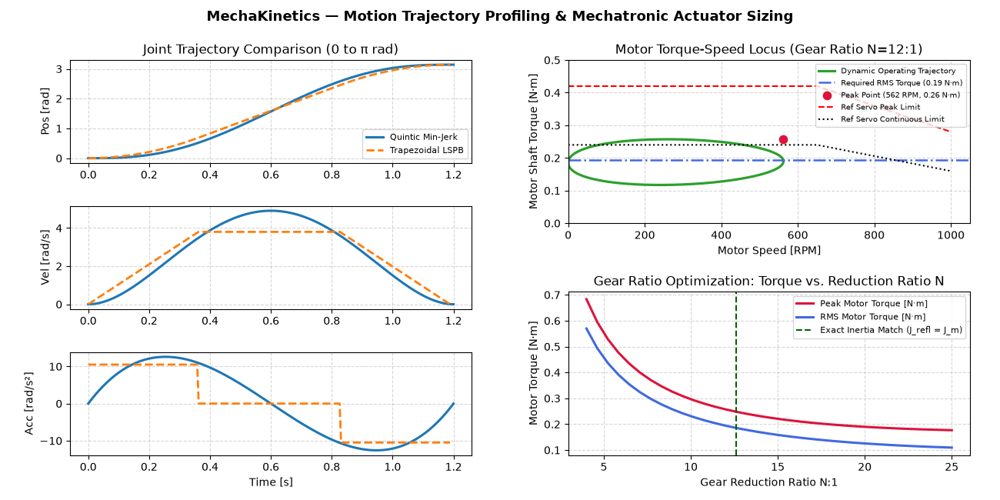

# MechaKinetics 

[](https://github.com/Akinlabi-Mechatronics-Biomed/mechakinetics/actions/workflows/ci.yml)
[](LICENSE)
[](https://www.python.org/)

**MechaKinetics** is an open-source Python engineering toolkit and interactive workbench for **serial-link robotic manipulator kinematics**, **omnidirectional mobile robot locomotion**, **smooth motion trajectory profiling**, and **mechatronic actuator/drivetrain sizing**.






---

## Who It's For
Built for mechatronics engineers, mechanical designers, and robotics developers who need a well-tested Python library, command-line interface (CLI), and visual simulation studio for kinematic verification, motion profiling, and servo/gearbox selection prior to CAD freeze or embedded firmware deployment.

## Core Modules & Tech Stack
- **`mechakinetics.transforms`:** $SO(3)$ rotation matrices, $SE(3)$ homogeneous transformations, and standard Denavit-Hartenberg (DH) link matrices (`numpy`).
- **`mechakinetics.kinematics`:** Forward kinematics ($T_0^N$), intermediate link frame extraction, and $6 \times N$ geometric space Jacobians for revolute and prismatic chains.
- **`mechakinetics.inverse_kinematics`:** Damped Least Squares (Levenberg-Marquardt) numerical Inverse Kinematics solver with step-norm clamping, angle wrapping, and box joint limits.
- **`mechakinetics.mobile`:** Forward/inverse velocity kinematics and midpoint Runge-Kutta $SE(2)$ dead-reckoning odometry for **4WD Mecanum** holonomic platforms and **Differential Drive** robots.
- **`mechakinetics.trajectory`:** Rest-to-rest **Quintic Polynomial (minimum-jerk)** and **Trapezoidal Velocity (LSPB)** trajectory planners.
- **`mechakinetics.actuator_sizing`:** Reflected load inertia ($J_L / N^2$), inertia mismatch ratio, continuous RMS torque, peak acceleration torque, and gear ratio sweep analysis.
- **`mechakinetics.cli` & `app.py`:** Command-line engineering utility and interactive **Streamlit** web dashboard (`matplotlib`, `streamlit`).

---

## Installation & How to Run

### 1. Clone & Install
```bash
git clone https://github.com/Akinlabi-Mechatronics-Biomed/mechakinetics.git
cd mechakinetics
pip install -e ".[dev]"
pip install -r requirements.txt
```

### 2. Run the Automated Unit Test Suite
```bash
pytest -v
```

### 3. Run the Command-Line Interface (CLI)
**Size a servo motor and gearbox for a point-to-point move:**
```bash
python -m mechakinetics.cli size-motor --move-rad 3.1416 --duration 1.2 --gear-ratio 12 --load-inertia 0.035 --load-torque 2.0
```

**Calculate 4WD Mecanum wheel angular speeds from desired chassis twist:**
```bash
python -m mechakinetics.cli mecanum --vx 0.5 --vy -0.25 --omega 0.4
```

### 4. Launch the Interactive Web Studio (Streamlit)
```bash
streamlit run app.py
```

### 5. Run Standalone Matplotlib Visualizers
```bash
python -m examples.visualize_day1
python -m examples.visualize_day2
python -m examples.visualize_day3
```

---

## Roadmap — Upcoming Engineering Work (25+ Hours Planned)

### Completed in `v0.1.0`
- [x] $SO(3)$ / $SE(3)$ transformations and standard DH forward kinematics + space Jacobians
- [x] Numerical Inverse Kinematics solver (Damped Least Squares with joint-limit clamping)
- [x] Holonomic 4WD Mecanum & Differential Drive velocity kinematics and $SE(2)$ odometry
- [x] Quintic polynomial & Trapezoidal LSPB trajectory generators
- [x] Mechatronic drivetrain & servo sizing engine + CLI + Streamlit web app

### Planned for `v0.2.0` — Full 6-DOF Pose IK, Dynamics & Control (~14 Hours)
- [ ] **Full 6-DOF Pose Inverse Kinematics (`orientation + position`):** Upgrade IK solver to track full $SE(3)$ target poses using axis-angle / quaternion orientation error vectors and null-space posture optimization.
- [ ] **Recursive Newton-Euler Inverse Dynamics (RNE):** Compute required joint torques ${\tau} = M(\mathbf{q})\ddot{\mathbf{q}} + C(\mathbf{q}, \dot{\mathbf{q}})\dot{\mathbf{q}} + \mathbf{g}(\mathbf{q})$ for multi-link manipulators under gravity and payload wrenches.
- [ ] **Closed-Loop PID & Computed-Torque Control Simulator:** Add discrete-time PID and feedforward controller simulation with sensor noise and actuator saturation.
- [ ] **S-Curve (7-Segment Jerk-Limited) Trajectory Planner:** Implement industrial 7-segment bounded-jerk motion profiling alongside multi-waypoint cubic spline interpolation.

### Planned for `v0.3.0` — Collision Checking, Path Planning & URDF Import (~12 Hours)
- [ ] **URDF & YAML Robot Description Parser:** Load standard `.urdf` and `.yaml` robot definitions directly into `SerialManipulator` and `DrivetrainParameters`.
- [ ] **2D/3D Workspace Obstacle Collision Detection:** Capsule and sphere bounding-volume collision checks for manipulator links and mobile robot footprints.
- [ ] **Sampling-Based Motion Planning (RRT / RRT\* & A\*):** Joint-space RRT* planner for manipulators and occupancy-grid A* path planner for Mecanum mobile rovers.
- [ ] **Thermal Motor Winding & Gearbox Fatigue Calculator:** $I^2 R$ copper loss thermal rise estimation and AGMA/ISO gear tooth bending/contact stress safety factors.

---

## Author & License
Created and maintained by **Akinlabi**. Released under the [MIT License](LICENSE).